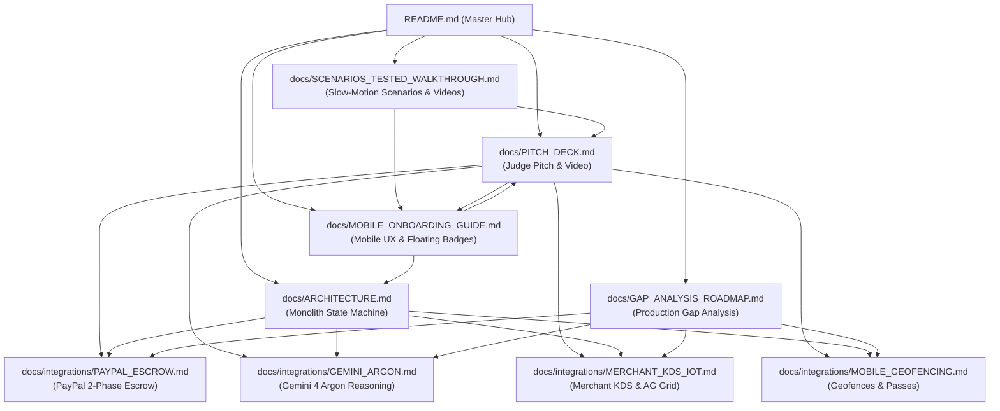

# 🥪 BitePass — Autonomous Proactive Culinary Concierge

> **Agentic Micro-Commerce Engine** powered by **Gemini 4 Argon**, **PayPal 2-Phase Escrow**, and **AG Grid React v33**.  
> *Target Tracks: PayPal AI Agent Track & AG Grid Observability Track*

---

## 🧭 Master Connected Documentation Graph

Every document in this repository is part of a bidirectional connected graph. Click any node below to navigate directly to its architectural specification, walkthrough guide, or implementation doc:



* **🧪 [Test Scenarios & Slow-Motion Video Showcase](docs/SCENARIOS_TESTED_WALKTHROUGH.md)** — Comprehensive breakdown of every tested user journey with dedicated slow-motion video clips.
* **🎙️ [Step-by-Step Pitch Deck & Video Guide](docs/PITCH_DECK.md)** — Complete 90-second judge script, master video walkthrough, and unit economics.
* **📱 [Mobile Onboarding & UX Architecture Guide](docs/MOBILE_ONBOARDING_GUIDE.md)** — Floating photo scenario badges, sliding animations, and the 4-step onboarding modal.
* **🏗️ [System Architecture & State Machine](docs/ARCHITECTURE.md)** — Zero-latency monolith design, order lifecycle, and interface contracts.
* **💳 [PayPal 2-Phase Escrow Integration](docs/integrations/PAYPAL_ESCROW.md)** — Pre-authorization holds (`intent: "AUTHORIZE"`), doorstep capture, and Fastlane vaulting.
* **🧠 [Gemini 4 Argon Reasoning Integration](docs/integrations/GEMINI_ARGON.md)** — Proactive scheduling, structured JSON outputs, and quiet-hours guardrails.
* **🍳 [Merchant KDS & AG Grid Integration](docs/integrations/MERCHANT_KDS_IOT.md)** — AG Grid React v33 real-time queue, Toast POS bridge, and IoT smart lockers.
* **📍 [Mobile Geofencing & Passes Integration](docs/integrations/MOBILE_GEOFENCING.md)** — CoreLocation <50m proximity capture and Apple/Google Wallet contactless passes.
* **🗺️ [Production Gap Analysis & 90-Day Roadmap](docs/GAP_ANALYSIS_ROADMAP.md)** — Comprehensive matrix of mocked vs. production enterprise components.
* **💡 [Lessons Learned & Radical Decluttering](LESSONS_LEARNED_V2.md)** — Mobile-first design principles that eliminated cognitive overload.

---

## 🎬 Slow-Motion Feature Walkthrough (Updated Interface)

Recorded at a mobile viewport (390px × 844px iPhone standard) with `slowMo: 600ms`, demonstrating the interactive onboarding guide, the floating photo scenario badges, 1-tap PayPal escrow, doorstep proximity auto-settlement, and live AG Grid kitchen queue:

<video controls width="100%" playsinline preload="metadata">
  <source src="public/videos/pitch_walkthrough.mp4" type="video/mp4">
  <source src="public/videos/pitch_walkthrough.webm" type="video/webm">
  Your browser does not support the video tag.
</video>

* **🎬 Play / Download Video:** [public/videos/pitch_walkthrough.mp4](public/videos/pitch_walkthrough.mp4) (H.264 &middot; 575 KB &middot; 34.8s)
* **WebM Source (VP9):** [public/videos/pitch_walkthrough.webm](public/videos/pitch_walkthrough.webm)
* **🧪 Individual Scenario Clips:** [docs/SCENARIOS_TESTED_WALKTHROUGH.md](docs/SCENARIOS_TESTED_WALKTHROUGH.md)
* **Playwright Pitch Script:** [`tests/e2e/pitch-demo.spec.ts`](tests/e2e/pitch-demo.spec.ts)

---

## ⚡ The BitePass User Journey in 5 Steps

```
[ Calendar Gap Detected ] 
       ↓ 
[ Interactive Onboarding / Floating Badges ]
       ↓ 
[ 1-Tap PayPal Escrow Hold ($14.50) ] 
       ↓ 
[ Kitchen Assembles & Reserves Bay ] 
       ↓ 
[ Doorstep Arrival (<50m) Auto-Settles Payment & Unlocks Cubby ]
```

1. **Ambient Awareness:** Gemini 4 Argon detects a 35m gap before your next meeting. It checks cafe lines and suggests a fresh meal:
   > *"35m gap before Standup · 3m walk to Jack's Cafe"*
2. **Docked Floating Scenario Badges:** Tap the circular badges on the right edge of the food photo to test Vegan, Lunch, Doorstep, or Late modes without pushing the checkout button below the fold. Tap `"How it works"` to launch the 4-step interactive onboarding guide.
3. **1-Tap Zero-Risk Escrow:** Tap `[ ⚡ Hold with PayPal · $14.50 ]`. Funds are placed in escrow via PayPal Orders v2 (`intent: "AUTHORIZE"`). No money is captured yet.
4. **Synchronized Prep:** Kitchen prepares your meal with a live walking countdown and designates a pickup station: **Pickup Cubby #D (Grab & Go)**.
5. **Hands-Free Proximity Capture:** As you walk up to the cafe door (< 50m), the geofence triggers Phase 2 capture. Your phone displays the **FASTPASS Contactless Pass**, and you grab your food without waiting.

---

## 🛠️ Technology Stack

| Layer | Technology | Key Purpose |
| :--- | :--- | :--- |
| **Framework** | Next.js 15 (App Router) | Fullstack React monolith with zero distributed latency |
| **Language** | TypeScript (Strict) | End-to-end type safety and deterministic schema contracts |
| **AI Intelligence** | Gemini 4 Argon (`@google/genai`) | Autonomous contextual reasoning and structured JSON output |
| **Payment Escrow** | PayPal Orders v2 REST API | 2-phase authorization hold and doorstep proximity capture |
| **Observability** | AG Grid React v33 | Real-time merchant queue board and bay capacity management |
| **Styling** | Modern CSS + Tailwind CSS | Warm culinary palette (`#FAF9F5`), mobile-first responsive layout |
| **Testing** | Vitest & Playwright | Full unit, integration, and slow-motion end-to-end browser tests |

---

## 🚀 Quickstart Guide

### 1. Installation
```bash
git clone https://github.com/jonatassouza/bitepass.git
cd bitepass
npm install
```

### 2. Environment Configuration (Optional)
BitePass runs out-of-the-box with an automated, transparent offline mock mode. To connect live credentials:
```bash
cp .env.example .env.local
# Set your GEMINI_API_KEY, PAYPAL_CLIENT_ID, and PAYPAL_CLIENT_SECRET
```

### 3. Run Locally
```bash
npm run dev
# Open http://localhost:3000 on your mobile browser or desktop
```

### 4. Run Test Suite
```bash
# Run unit & API integration tests (Vitest: 17/17 passed)
npm test

# Run all end-to-end browser tests across Desktop & Mobile viewports (Playwright)
npm run test:e2e

# Run dedicated Mobile Viewport (iPhone / 390px) test suite (Playwright)
npm run test:mobile

# Run slow-motion feature walkthrough test with video recording
npm run test:pitch
```

---

## ⚖️ License
Proprietary (`UNLICENSED`) &middot; Copyright &copy; 2026 BitePass Inc. All Rights Reserved. See [LICENSE](LICENSE).
