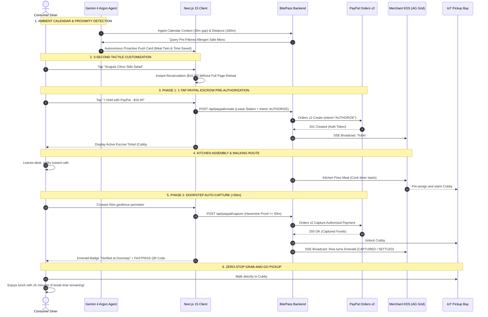

# 🗺️ BitePass — Complete End-to-End User Journey

> A comprehensive walkthrough of the end-to-end user lifecycle across all participating actors: **Consumer**, **Autonomous AI Concierge (Gemini 4 Argon)**, **Merchant Kitchen Operator**, **PayPal Escrow Ledger**, and the **Physical Cubby IoT Station**.

---

## 🧭 High-Level Journey Lifecycle Flow

---

## 📍 Stage-by-Stage Detailed Breakdown

### Stage 1: Ambient Context & Proactive Trigger (No App Opening Required)
* **Actor:** Consumer & Gemini 4 Argon Agent
* **Context Detected:**
  * Calendar Gap: `35 minutes free before 1:30 PM Standup`.
  * Spatial Proximity: `180 meters (~2.5 minutes walk) to Jack's Cafe`.
  * Diner Profile: `Omnivore, no peanuts/shellfish`.
* **Autonomous Decision:**
  * Agent verifies gap exceeds the 30-minute threshold (preventing spam during crunch periods).
  * Selects the highest-rated meal match: **Artisanal Turkey Avocado Club & Sea Salt Kettle Chips (\$14.50)**.
  * Surfaces a glassmorphic push card on the diner's screen with the value badge:  
    `⚡ 18 MINS SAVED | 35M MEETING GAP DETECTED`.

---

### Stage 2: 3-Second Tactile Micro-Customization
* **Actor:** Consumer
* **Experience:**
  * No 60-item menu paralysis or endless category scrolling.
  * User sees a clean 2-chip side choice:
    * `[ ✓ Sea Salt Kettle Chips ]` *(Included)*
    * `[ Arugula Citrus Side Salad +$1.50 ]`
  * Diner taps the side salad. The total dynamically updates to **\$16.00** with integer-cents mathematical precision (`lib/pricing.ts`).

---

### Stage 3: Phase 1 — 1-Tap PayPal Escrow Authorization
* **Actor:** Consumer & PayPal API
* **Action:** Diner taps **`[ ⚡ Hold with PayPal · $16.00 ]`**.
* **Under the Hood:**
  * Server invokes `POST /api/paypal/create` with `intent: "AUTHORIZE"`.
  * Leases an active kitchen station and pre-assigns **Pickup Cubby #D**.
  * Diner is charged **\$0.00** at this moment. Funds are held in escrow.
  * A 90-second Grace Window begins, allowing free cancellation if an urgent meeting arises.
  * The consumer view transitions seamlessly into the **Active Escrow Preparation Ticket** with live walking radar.

---

### Stage 4: Synchronized Kitchen Preparation
* **Actor:** Merchant Kitchen Staff & AG Grid KDS
* **Experience:**
  * The Merchant KDS terminal (`/merchant`) instantly receives the order via Server-Sent Events (`GET /api/events`).
  * Ticket `#ORD-104` appears in the AG Grid queue in amber status `AUTHORIZED_QUEUED`.
  * Kitchen staff hits **`Accept & Fire`** on the gloved-operator touch display.
  * The meal is assembled and placed directly into **Pickup Cubby #D**.

---

### Stage 5: Phase 2 — Contactless Doorstep Capture (<50m)
* **Actor:** Consumer, Mobile Geofence Engine & PayPal API
* **Action:** Diner walks downstairs and crosses the **50-meter geofence perimeter**.
* **Under the Hood:**
  * Mobile browser/PWA detects proximity (`<50m`) via geolocation/BLE.
  * Calls `POST /api/paypal/capture` with server-side Haversine verification.
  * PayPal captures the previously authorized hold via crash-safe 3-phase settlement (`CAPTURING` $\to$ PayPal API $\to$ `CAPTURED`).
  * Merchant payout is guaranteed; cubby latch is unlocked.
  * Consumer screen flashes emerald: **`✓ Verified at Doorstep. Captured via PayPal`** and displays the scannable **FASTPASS QR Code**.

---

### Stage 6: Contactless 0-Second Grab-and-Go
* **Actor:** Consumer & IoT Cubby
* **Action:**
  * Diner walks past the cash register and long order lines directly to **Pickup Cubby #D**.
  * Grabs the hot, freshly packaged meal.
  * Walks away to enjoy lunch with 25 minutes to spare.

---

### Stage 7: Guardrails & 2-Tap Dispute Resolution (Post-Pickup)
* **Actor:** Consumer & Automated Dispute Token
* **Safety Features:**
  * If an order is missing an item or incorrect, the diner taps **`[ 2-Tap Cubby Dispute / Refund ]`**.
  * The system issues an automated escrow refund via PayPal API, quarantines the cubby for sanitation inspection on the merchant AG Grid, and notifies kitchen staff in real time.

