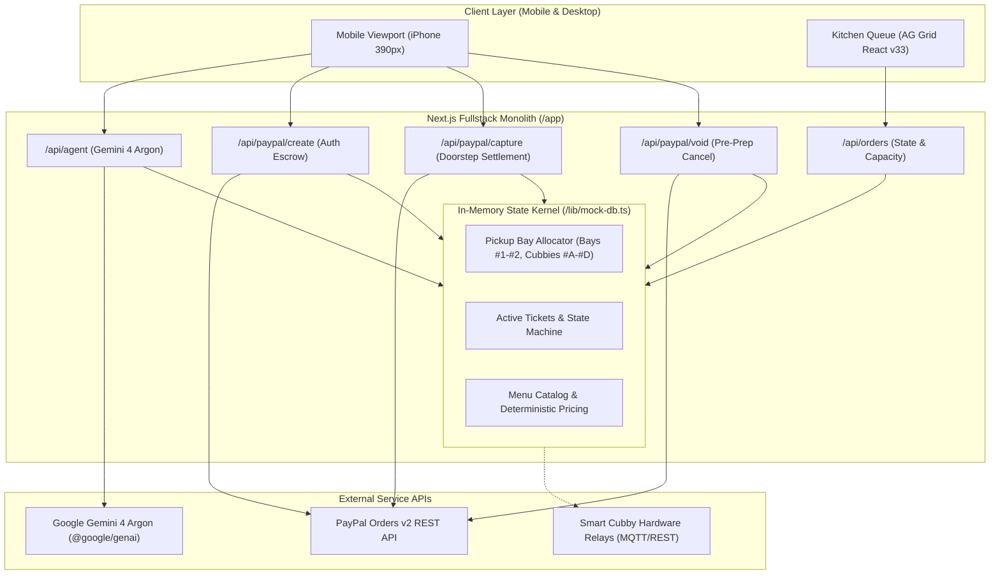
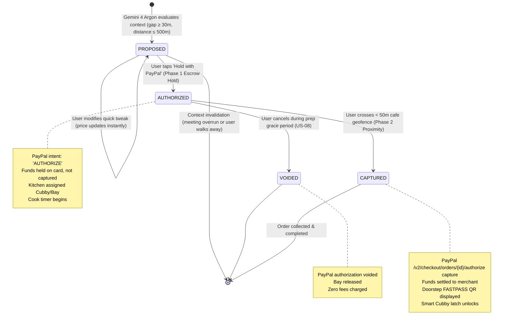

# 🏗️ BitePass — System Architecture & Monolith State Machine

> **Product:** BitePass — Autonomous Proactive Culinary Concierge  
> **Master Graph Hub:** [README.md](../README.md) &middot; [Pitch Deck](PITCH_DECK.md) &middot; [Gap Analysis](GAP_ANALYSIS_ROADMAP.md)  
> **Integrations:** [PayPal Escrow](integrations/PAYPAL_ESCROW.md) &middot; [Gemini 4 Argon](integrations/GEMINI_ARGON.md) &middot; [Merchant KDS & AG Grid](integrations/MERCHANT_KDS_IOT.md) &middot; [Mobile Geofencing](integrations/MOBILE_GEOFENCING.md)

---

## 1. High-Level Architecture: Zero-Latency Monolith

BitePass is engineered as a **ruthlessly simple, zero-latency fullstack Next.js monolith**. Rather than deploying a dozen microservices, Docker swarms, Kafka message brokers, and distributed databases for a hackathon demo, BitePass packages the client experience, agent cognitive engine, PayPal escrow adapter, and kitchen operations into a single, cohesive runtime:



---

## 2. Order Ticket State Transition Machine

Every transaction passes through a deterministic state machine strictly bound to the 2-phase PayPal escrow lifecycle:



---

## 3. Data Models & Interface Contracts

The core interfaces in [`lib/types.ts`](../lib/types.ts):

### `MenuItem`
```typescript
export interface MenuItem {
  id: string;
  name: string;
  merchantName: string;
  category: string;
  price: number;
  prepTimeMinutes: number;
  dietaryTags: DietaryPreference[];
  description: string;
  calories: number;
  image?: string;
  quickTweaks?: {
    label: string;
    options: { name: string; priceDelta: number }[];
  };
}
```

### `OrderTicket`
```typescript
export type OrderStatus = 'PROPOSED' | 'AUTHORIZED' | 'CAPTURED' | 'VOIDED';

export interface OrderTicket {
  orderId: string;
  authId?: string;
  captureId?: string;
  customerName: string;
  item: MenuItem;
  selectedTweak?: string;
  status: OrderStatus;
  cubbyOrBay: string;
  etaMinutes: number;
  createdAt: string;
  totalAmount: number;
}
```

### `AgentRecommendation`
```typescript
export interface AgentRecommendation {
  shouldTrigger: boolean;
  item?: MenuItem;
  reason?: string;
  timeSavedMinutes?: number;
  walkingBufferMinutes?: number;
  total?: number;
  breakdown?: {
    basePrice: number;
    tax: number;
    tip: number;
    total: number;
  };
}
```

---

## 4. Key Architectural Decisions (ADRs)

1. **Zero Hallucination Pricing:** All prices, municipal basis-point taxes, and tips are computed deterministically in integer cents in [`lib/pricing.ts`](../lib/pricing.ts). Gemini 4 Argon selects items by ID; it never invents numeric dollar amounts.
2. **Two-Phase Escrow vs. Immediate Charge:** Immediate checkout creates buyer friction and high refund costs if meetings overrun. By using PayPal `intent: "AUTHORIZE"`, the user risks nothing until they physically reach the cafe door.
3. **In-Memory Reactive Kernel:** Orders and bay allocations live in a singleton store that responds in `< 5ms`. In production, this kernel swaps to Redis Pub/Sub + Postgres without modifying route handler signatures.
4. **Mobile-First Responsive Layout:** Designed around a 390px mobile viewport with above-the-fold 1-tap checkout, paired with AG Grid React v33 on a dedicated merchant tab for observability.

---

## 5. Connected Graph

* 🎙️ **Pitch & Demo:** [PITCH_DECK.md](PITCH_DECK.md)
* 💳 **PayPal Escrow Integration:** [integrations/PAYPAL_ESCROW.md](integrations/PAYPAL_ESCROW.md)
* 🧠 **Gemini 4 Argon Integration:** [integrations/GEMINI_ARGON.md](integrations/GEMINI_ARGON.md)
* 🍳 **Merchant KDS & AG Grid:** [integrations/MERCHANT_KDS_IOT.md](integrations/MERCHANT_KDS_IOT.md)
* 📍 **Geofencing & Passes:** [integrations/MOBILE_GEOFENCING.md](integrations/MOBILE_GEOFENCING.md)
* 🗺️ **Gap Analysis & Roadmap:** [GAP_ANALYSIS_ROADMAP.md](GAP_ANALYSIS_ROADMAP.md)
