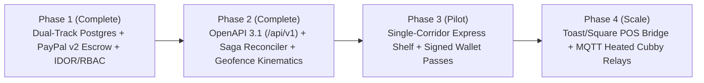

# 🗺️ BitePass — Production Readiness Matrix & Commercial Scale Roadmap

> **Master Graph Hub:** [README.md](../README.md) &middot; [Pitch Deck](PITCH_DECK.md) &middot; [Architecture](ARCHITECTURE.md) &middot; [OpenAPI 3.1](../openapi/openapi.v1.json)  
> **Integrations:** [PayPal Escrow](integrations/PAYPAL_ESCROW.md) &middot; [Gemini 4 Argon](integrations/GEMINI_ARGON.md) &middot; [Merchant KDS & AG Grid](integrations/MERCHANT_KDS_IOT.md) &middot; [Mobile Geofencing](integrations/MOBILE_GEOFENCING.md)  
> **Runbooks:** [RB-01 Orphaned Holds](runbooks/RB-01-orphaned-paypal-holds.md) &middot; [RB-02 Webhook Replay](runbooks/RB-02-paypal-webhook-dlq-replay.md) &middot; [RB-03 KDS & Cubby Override](runbooks/RB-03-kds-cubby-manual-override.md)

---

## 1. Production Subsystem Status Matrix (v0.2.0)

This matrix maps every architectural subsystem from initial prototype through the implemented v0.2.0 production hardening and Phase 3 hardware scale-out:

| Subsystem | Implemented Production Foundation (v0.2.0) | Phase 3 Commercial Hardware Scale-Out | Status |
| :--- | :--- | :--- | :--- |
| **Payment Authorization** | PayPal Orders v2 (`intent: "AUTHORIZE"`), Vault v3 + Multiparty `payee` + `platform_fees`, fail-closed live safety ([lib/paypal-client.ts](../lib/paypal-client.ts)) | Biometric Passkey / Fastlane native mobile SDK binding | **Production Ready** |
| **Payment Settlement** | Crash-safe `CAPTURING` saga + reconciler ([lib/reconciler.ts](../lib/reconciler.ts)), server-side Haversine `<=50m` + `<=12 m/s` velocity & `<=15s` GPS freshness ([lib/validation.ts](../lib/validation.ts)) | Encrypted rotating Eddystone-EID physical doorway beacons | **Production Ready** |
| **State Persistence** | Dual-Track Hexagonal Repository ([lib/repositories/kitchen-repository.ts](../lib/repositories/kitchen-repository.ts)): `InMemory` + PostgreSQL Prisma `FOR UPDATE SKIP LOCKED` & `idx_station_one_active_order` | Multi-region read replicas + Redis Cluster rate-limit store | **Production Ready** |
| **API Contract & AuthZ** | Versioned `/api/v1/*` + OpenAPI 3.1 ([openapi/openapi.v1.json](../openapi/openapi.v1.json)), IDOR ownership guards ([lib/security.ts](../lib/security.ts)), RFC 9745 deprecation headers ([middleware.ts](../middleware.ts)) | OAuth2 / OIDC enterprise SSO federation | **Production Ready** |
| **Kitchen Operations** | Granular AG Grid v33 KDS ([components/MerchantQueueGrid.tsx](../components/MerchantQueueGrid.tsx)) with `SETTLE_AND_UNLOCK`, `CLEAR_QUARANTINE`, `+5m` 60s free-cancel reopen, and `MERCHANT.PARTNER-CONSENT.REVOKED` guard | Toast POS / Square POS bidirectional ticket bridge | **Production Ready** |
| **Contactless Pickup** | HMAC-signed Wallet Pass bundle (`/api/v1/orders/[orderId]/wallet-pass`), offline QR token, Express Shelf "Color-of-the-Day" badge, `.ics` calendar export | Physical heated locker MQTT relays (Apex / Minnow) | **Production Ready** |
| **Privacy & Compliance** | `/legal/terms`, `/legal/privacy`, Reg E pre-authorized capture notice, and `DELETE /api/v1/account/data` GDPR/CCPA erasure | SOC 2 Type II continuous control attestation | **Production Ready** |

---

## 2. Phased Commercial Rollout Flow

---

## 3. Regulatory, Privacy & Security Guarantees

1. **PCI-DSS SAQ-A:** Payment credentials never touch BitePass infrastructure; all authorizations, partial COGS captures, voids, and refunds execute via PayPal Orders v2 & Payments v2 APIs.
2. **Ephemeral Proximity Telemetry:** Geofence coordinates are verified strictly in memory (`<=50m` Haversine, `<=15s` freshness, `<=12 m/s` velocity ceiling) and discarded; only coarse scalar distance is retained for dispute defense.
3. **3-Hour Escrow Expiry Guarantee:** Unsettled authorizations older than 3 hours are automatically voided and stations released via `POST /api/v1/internal/reconcile` ([lib/reconciler.ts](../lib/reconciler.ts)).
4. **GDPR Art. 17 / CCPA Right to Delete:** Diners can invoke `DELETE /api/v1/account/data` at any time to void active holds, scrub order PII, and clear signed session cookies.

---

## 4. Connected Graph

* 🏠 **Hub:** [README.md](../README.md) &middot; [SECURITY.md](../SECURITY.md) &middot; [CONTRIBUTING.md](../CONTRIBUTING.md) &middot; [CHANGELOG.md](../CHANGELOG.md)
* 🎙️ **Pitch & Demo:** [PITCH_DECK.md](PITCH_DECK.md)
* 🏗️ **Architecture:** [ARCHITECTURE.md](ARCHITECTURE.md)
* 💳 **PayPal Escrow Integration:** [integrations/PAYPAL_ESCROW.md](integrations/PAYPAL_ESCROW.md)
* 🧠 **Gemini 4 Argon Reasoning:** [integrations/GEMINI_ARGON.md](integrations/GEMINI_ARGON.md)
* 🍳 **Merchant KDS & AG Grid:** [integrations/MERCHANT_KDS_IOT.md](integrations/MERCHANT_KDS_IOT.md)
* 📍 **Geofencing & Passes:** [integrations/MOBILE_GEOFENCING.md](integrations/MOBILE_GEOFENCING.md)
