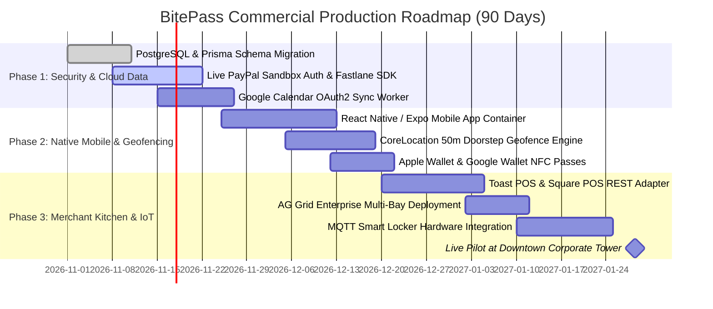

# 🗺️ BitePass — Production Gap Analysis & 90-Day Commercial Roadmap

> **Master Graph Hub:** [README.md](../README.md) &middot; [Pitch Deck](PITCH_DECK.md) &middot; [Architecture](ARCHITECTURE.md)  
> **Integrations:** [PayPal Escrow](integrations/PAYPAL_ESCROW.md) &middot; [Gemini 4 Argon](integrations/GEMINI_ARGON.md) &middot; [Merchant KDS & AG Grid](integrations/MERCHANT_KDS_IOT.md) &middot; [Mobile Geofencing](integrations/MOBILE_GEOFENCING.md)

---

## 1. Exhaustive Gap Analysis Matrix

This matrix details every subsystem currently mocked or simplified for the zero-latency hackathon prototype, alongside the exact enterprise components required for commercial production:

| Subsystem | Hackathon Working Prototype | Production Commercial Standard | Complexity | Target Timeline |
| :--- | :--- | :--- | :--- | :--- |
| **Payment Authorization** | Mock fallback + PayPal REST API adapter | **PayPal Fastlane + Vault v3** with biometric device binding (zero-redirect 1-tap checkout) | Medium | Month 1 |
| **Payment Settlement** | Client-initiated REST capture trigger | Server-validated **Proximity Capture** authenticated with cryptographic BLE beacon telemetry | Medium | Month 2 |
| **Calendar Ingestion** | Slider & preset simulation | **Google Calendar & Outlook 365 OAuth2** sync with real-time delta webhook listeners | Low | Month 1 |
| **Location Tracking** | React state distance slider | Native iOS **CoreLocation** & Android **FusedLocation** with battery-saving circular geofences | Medium | Month 2 |
| **Kitchen Operations** | In-memory singleton + AG Grid React v33 | **Toast POS API / Square POS Bridge** + AG Grid Enterprise with Server-Side Row Model | High | Month 3 |
| **Smart Locker Hardware**| Simulated cubby assignment | Physical heated locker arrays (Apex / Minnow) controlled via **MQTT relays & GPIO controllers** | High | Month 3 |
| **State Persistence** | In-memory TypeScript store (`lib/mock-db.ts`) | **PostgreSQL (Supabase/Prisma) + Redis** for distributed multi-tenant order state & queue locks | Low | Month 1 |
| **Push Notifications** | Simulated browser cards | Native **Apple APNs & Firebase Cloud Messaging (FCM)** for ambient lock screen push cards | Medium | Month 2 |
| **Contactless Pickup** | In-app QR code component | Native **Apple Wallet (`.pkpass`) & Google Wallet API** with NFC tap support | Medium | Month 2 |

---

## 2. 90-Day Phased Implementation Roadmap

---

## 3. Regulatory, Privacy & Security Requirements

1. **PCI-DSS Compliance:** Because BitePass leverages PayPal Orders v2 and PayPal Fastlane, payment credentials never touch BitePass servers. BitePass qualifies for the simplified **PCI DSS SAQ-A** standard.
2. **Location Privacy:** Location tracking activates strictly within the 30 minutes before a recognized meal window and shuts off immediately upon order collection. No persistent location logs are stored.
3. **Escrow Guarantee:** Customer funds are held in escrow for a maximum of 3 hours. If uncaptured, a cron worker automatically executes `v2/payments/authorizations/{id}/void`.

---

## 4. Connected Graph

* 🏠 **Hub:** [README.md](../README.md)
* 🎙️ **Pitch & Demo:** [PITCH_DECK.md](PITCH_DECK.md)
* 🏗️ **Architecture:** [ARCHITECTURE.md](ARCHITECTURE.md)
* 💳 **PayPal Escrow Integration:** [integrations/PAYPAL_ESCROW.md](integrations/PAYPAL_ESCROW.md)
* 🧠 **Gemini 4 Argon Reasoning:** [integrations/GEMINI_ARGON.md](integrations/GEMINI_ARGON.md)
* 🍳 **Merchant KDS & AG Grid:** [integrations/MERCHANT_KDS_IOT.md](integrations/MERCHANT_KDS_IOT.md)
* 📍 **Geofencing & Passes:** [integrations/MOBILE_GEOFENCING.md](integrations/MOBILE_GEOFENCING.md)
