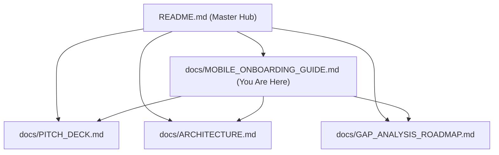

# 📱 BitePass — Mobile Onboarding & UX Architecture Guide

> **Domain:** Mobile UX Architecture, Floating Photo Scenario Badges & Interactive Onboarding  
> **Master Graph Hub:** [README.md](../README.md) &middot; [Pitch Deck](PITCH_DECK.md) &middot; [Architecture](ARCHITECTURE.md) &middot; [Gap Analysis](GAP_ANALYSIS_ROADMAP.md)

---

## 1. Executive Summary

BitePass is designed for extreme speed and zero cognitive load:
- **No Browsing Fatigue**: The autonomous culinary agent (powered by Gemini 4 Argon) monitors ambient calendar gaps and GPS proximity.
- **Above-The-Fold Conversion**: On a standard mobile screen (e.g., iPhone 14/15/16 at 390px × 844px), the hero food photo, details, and the primary **1-Tap PayPal Escrow** button fit entirely above the fold without scrolling.
- **Docked Floating Badges**: Rather than wasting vertical space above the card with horizontal chips, scenario presets are positioned directly on the right edge of the food photo inside an opaque, frosted glass container.

---

## 2. Floating Photo Scenario Badges (`CulinaryRecommendationCard.tsx`)

### Visual Design & Positioning
- **Container**: `bg-black/60 backdrop-blur-md border border-white/15 p-1.5 rounded-2xl flex flex-col gap-2 shadow-2xl`
- **Position**: `absolute right-2.5 top-1/2 -translate-y-1/2 z-20`
- **Contrast Guarantee**: The dark frosted container ensures crisp white icons and text readability across any food photography background.

### The 4 Interactive Badges
1. **🚶 12:15 PM Lunch (`UtensilsCrossed`)**:
   - Simulates the standard 40m lunch gap at 200m walking distance.
   - Highlights in warm terracotta (`#E05A38`) with an active white ring when active.
2. **🚪 Doorstep (<50m) (`MapPin`)**:
   - Simulates crossing the 50m geofence threshold.
   - Highlights in emerald green (`bg-emerald-600`) when inside the geofence.
3. **🥗 Vegan (`Leaf`)**:
   - Toggles dietary preferences between Omnivore and Vegan.
   - Dynamically re-evaluates the menu (swapping Jack's Turkey Club for the Kale Quinoa Power Bowl).
   - Highlights in forest emerald (`bg-emerald-700`).
4. **⏱️ Late (<30m) (`Clock`)**:
   - Simulates calendar crunch (<30m free window).
   - Highlights in amber (`bg-amber-600`) and triggers the Agent's Ambient Silence mode.

### Sliding Micro-Interaction
- **Desktop**: Hovering over any circle triggers a smooth slide-out pill expanding to the **left** into the image area:
  `transition-all duration-300 ease-out opacity-0 translate-x-2 group-hover:opacity-100 group-hover:translate-x-0`
- **Mobile Touch**: Tapping any circular icon triggers the scenario action immediately and displays the sliding pill for 1.6 seconds.
- **Accessibility**: Semantic text (`sr-only` and visible pill labels) ensures screen readers and Playwright tests find and interact with each button effortlessly.

---

## 3. Mobile Onboarding Guide Walkthrough (`MobileOnboardingGuide.tsx`)

Accessible anytime via the **Guide (`BookOpen`)** button in the top navigation bar or the **"How it works"** link beneath the checkout button:

### The 4 Guided Steps
1. **Step 1: Autonomous AI Concierge**:
   Explains ambient evaluation — BitePass stays silent until a verified calendar gap (≥30m) and walking proximity (<500m) align.
2. **Step 2: Floating Photo Controls**:
   Instructs users on the new circular controls on the dish photo, complete with 1-tap shortcuts to test Lunch or Vegan scenarios.
3. **Step 3: 2-Phase PayPal Escrow**:
   Educates users on escrow safety: 1 tap authorizes $14.50, but **$0 is deducted** until physical arrival. Free instant cancellation before arrival.
4. **Step 4: Contactless Doorstep FASTPASS**:
   Demonstrates how the 50m geofence auto-releases funds upon arrival, displaying the digital FASTPASS with the assigned pickup bay.

---

## 4. Verification & Testing

Both unit and E2E test suites validate the mobile layout and floating badges:
- **Unit & Integration Suite**: `npm test` (Vitest: 17/17 passing)
- **E2E Mobile Suite**: `npm run test:mobile` (Playwright mobile emulation at 390px × 844px)
- **Pitch Walkthrough Video**: `npm run test:pitch` (Records slow-motion walkthrough with guide & floating badges to `public/videos/pitch_walkthrough.mp4`)

---

## 5. Connected Documentation Graph

