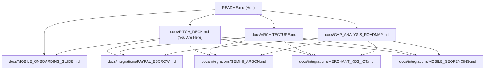

# 🎙️ BitePass — Step-by-Step Pitch & Feature Walkthrough

> **Product:** BitePass — Autonomous Proactive Culinary Concierge  
> **Target Audience:** Hackathon Judges, Angel Investors, Merchant Partners  
> **Tracks:** PayPal AI Agent Track & AG Grid Observability Track  
> **Master Graph Hub:** [README.md](../README.md) &middot; [Scenarios & Clips](SCENARIOS_TESTED_WALKTHROUGH.md) &middot; [Architecture](ARCHITECTURE.md) &middot; [Mobile UX Guide](MOBILE_ONBOARDING_GUIDE.md) &middot; [Gap Analysis](GAP_ANALYSIS_ROADMAP.md)

---

## 1. The 90-Second Elevator Pitch

> *"Every day, 50 million office workers lose 25 minutes of their lunch break to the 'food order tax'—standing in lines, browsing 50-item menus, typing 16-digit credit card numbers, and waiting at noisy cafe counters. Traditional delivery apps don't solve this; they add $10 in courier fees, arrive 20 minutes late, and deliver soggy sandwiches.
> 
> *Enter **BitePass**—the world’s first autonomous proactive micro-commerce agent. Powered by **Gemini 4 Argon** and **PayPal 2-Phase Escrow**, BitePass monitors your calendar gaps, checks the stone-oven schedule at Jack's Cafe downstairs, and proactively serves you a 1-tap lunch pass before you even feel hungry.
> 
> *You tap once to hold funds in escrow. You walk downstairs. The exact second your phone crosses the 50-meter cafe threshold, BitePass auto-settles the payment via PayPal and unlocks your designated grab-and-go cubby. Zero lines. Zero menus. Zero waiting. Fresh hot food ready the moment you walk through the door."*

---

## 2. Slow-Motion Video Walkthrough (Updated Interface)

The end-to-end user journey recorded in slow-motion using Playwright on a mobile viewport (390px × 844px iPhone standard), showing the interactive onboarding guide and the floating photo scenario badges:

<video controls width="100%" playsinline preload="metadata">
  <source src="../public/videos/pitch_walkthrough.mp4" type="video/mp4">
  <source src="../public/videos/pitch_walkthrough.webm" type="video/webm">
  Your browser does not support the video tag.
</video>

* **🎬 Play / Download Video:** [public/videos/pitch_walkthrough.mp4](../public/videos/pitch_walkthrough.mp4) (H.264 &middot; 575 KB &middot; 34.8 seconds)
* **WebM Source (VP9):** [public/videos/pitch_walkthrough.webm](../public/videos/pitch_walkthrough.webm)
* **Individual Scenario Slow-Motion Clips:** [docs/SCENARIOS_TESTED_WALKTHROUGH.md](SCENARIOS_TESTED_WALKTHROUGH.md)
* **Playwright Pitch Script:** [`tests/e2e/pitch-demo.spec.ts`](../tests/e2e/pitch-demo.spec.ts)

---

## 3. Step-by-Step Feature Walkthrough (As Shown in Video)

### Step 1: Ambient Context & Proactive Culinary Suggestion
* **What Happens:** The agent observes the user has a **35-minute calendar gap** before their 1:30 PM standup, is **200 meters** away, and has an omnivore taste profile.
* **Agent Status:**
  > `"35m gap before Standup · 3m walk to Jack's Cafe"`
* **Why It Wows:** The user didn't open an app or search. The agent reasoned over calendar schedules, walking buffers, and kitchen prep times to propose the optimal meal at the exact right moment.
* **Under the Hood:** Powered by Gemini 4 Argon with strict structured JSON output and autonomous quiet-hours guardrails (<30m suppresses interruptions). See [Gemini 4 Argon Integration Guide](integrations/GEMINI_ARGON.md).

### Step 2: Interactive Mobile Onboarding Walkthrough (`MobileOnboardingGuide.tsx`)
* **What Happens:** Tapping the `"How it works"` link beneath checkout (or the `BookOpen` icon in the navbar) opens an interactive 4-step modal:
  * **Step 1: Autonomous AI Concierge:** Explains ambient calendar/proximity monitoring.
  * **Step 2: Floating Photo Controls:** Explains the docked circular scenario badges on the dish image with 1-tap test shortcuts.
  * **Step 3: 2-Phase PayPal Escrow:** Reassures users that $0 leaves their account during kitchen prep.
  * **Step 4: Contactless Doorstep FASTPASS:** Explains hands-free geofence auto-pay upon arrival.
* **Documentation:** See [Mobile Onboarding Guide](MOBILE_ONBOARDING_GUIDE.md).

### Step 3: Docked Floating Photo Scenario Badges
* **What Happens:** Instead of bulky buttons pushing the checkout action below the fold, scenario controls are docked **directly on the right edge of the food photo** inside an opaque frosted glass container (`bg-black/60 backdrop-blur-md`):
  * **🚶 12:15 PM Lunch (`UtensilsCrossed`):** Simulates standard lunch window.
  * **🚪 Doorstep (<50m) (`MapPin`):** Simulates crossing the 50m geofence.
  * **🥗 Vegan (`Leaf`):** Instantly recalculates to the *Kale Quinoa Power Bowl ($13.50)*.
  * **⏱️ Late (<30m) (`Clock`):** Simulates calendar crunch and triggers Ambient Silence mode.
* **Micro-Interaction:** Hovering or tapping slides out a descriptive pill to the left into the image area.

### Step 4: 3-Second Tweak (Zero Menu Overload)
* **What Happens:** Rather than browsing a complex 60-item menu, the user sees a 2-chip side choice:
  * `[ ✓ Kettle Sea Salt Chips ]` *(Included)*
  * `[ Arugula Citrus Side Salad +$1.50 ]`
* **Interaction:** Tapping the salad instantly updates the all-in total to **$16.00**.

### Step 5: Phase 1 — 1-Tap PayPal Escrow Authorization (`intent: "AUTHORIZE"`)
* **What Happens:** The user taps the hero button:
  > **`[ ⚡ Hold with PayPal · $16.00 ]`**
* **Why It's Revolutionary:**
  * **Zero immediate charge:** Funds are held in escrow via PayPal Orders v2 with `intent: "AUTHORIZE"`.
  * If the user's meeting runs late or they cancel, funds are released with zero dispute fees.
  * Merchant receives a guaranteed authorization hold and begins prep immediately.
* **Under the Hood:** See [PayPal 2-Phase Escrow Integration Guide](integrations/PAYPAL_ESCROW.md).

### Step 6: Synchronized Prep & Assigned Pickup Cubby
* **What Happens:** The UI smoothly transitions to the **Active Escrow Preparation Ticket**:
  * Displays a live countdown timer: `4:58` (synchronized with walking time).
  * Designates the pickup location: **Pickup Cubby #D (Grab & Go)**.
  * Displays live geofence radar: `200m away`.
* **Merchant Sync:** Behind the scenes, the merchant's live terminal updates ticket `#ORD-104` to `AUTHORIZED (HOLD)`. See [Merchant KDS & AG Grid Guide](integrations/MERCHANT_KDS_IOT.md).

### Step 7: Phase 2 — Contactless Doorstep Proximity Capture (<50m)
* **What Happens:** As the user walks to the cafe and crosses the **50-meter geofence**:
  * Proximity trigger executes Phase 2 capture: `v2/checkout/orders/{id}/authorize` capture.
  * The app flashes an emerald verified badge: **`Captured via PayPal Escrow`**.
  * Presents the **FASTPASS Contactless QR code** to unlock Cubby #D.
* **Consumer Experience:** Walk in, grab the warm packaged meal from Cubby #D, and walk out. Zero time wasted at registers. See [Mobile Geofencing & Contactless Pass Guide](integrations/MOBILE_GEOFENCING.md).

### Step 8: Sponsor Track — Live Kitchen Operations (AG Grid React v33)
* **What Happens:** Switch to the **Kitchen Queue** tab in the top navigation.
* **Why Judges Love It:**
  * Live AG Grid with custom cell renderers, responsive status badges, and active bay telemetry.
  * Demonstrates real-time ticket progression: `PROPOSED` $\to$ `AUTHORIZED (HOLD)` $\to$ `CAPTURED / SETTLED`.
  * Demonstrates how commercial kitchens manage automated pick-up cubbies with zero extra cashier overhead.

---

## 4. Market Opportunity & Unit Economics

| Metric | Traditional Delivery (DoorDash/UberEats) | Traditional Takeout (Starbucks/Chipotle) | **BitePass Autonomous Concierge** |
| :--- | :--- | :--- | :--- |
| **User Wait Time** | 35–55 minutes | 12–18 minutes (line + prep) | **0 minutes (Grab & Go)** |
| **Added Fees** | $8.00–$12.00 (delivery + service fees) | $0.00 | **$0.00 (Zero consumer markup)** |
| **Merchant Take-Rate** | 25%–30% commission | POS processing (~2.9%) | **10% flat SaaS/transaction fee** |
| **Payment Model** | Immediate capture (high chargebacks) | Immediate capture | **2-Phase PayPal Escrow (Zero friction)** |
| **Food Quality** | Cold/soggy after transit | Stale if customer is delayed | **Synchronized to walking time** |

---

## 5. Connected Documentation Graph

