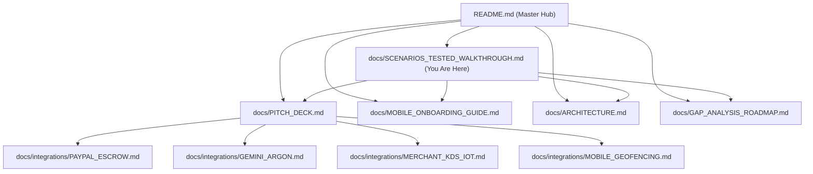

# 🧪 BitePass — Test Scenarios & Slow-Motion Video Showcase

> **Scope:** Comprehensive visual and automated verification of all end-to-end user journeys in BitePass.  
> **Mobile Test Harness:** Playwright Mobile Emulation (iPhone 14/15/16 at 390px × 844px) with `slowMo: 600ms`.  
> **Master Graph Hub:** [README.md](../README.md) &middot; [Pitch Deck](PITCH_DECK.md) &middot; [Mobile UX Guide](MOBILE_ONBOARDING_GUIDE.md) &middot; [Architecture](ARCHITECTURE.md)

---

## 🎬 Master Slow-Motion Video Walkthrough (Full Flow)

The complete end-to-end journey from proactive suggestion to contactless doorstep grab-and-go and live AG Grid kitchen queue:

<video controls width="100%" playsinline preload="metadata">
  <source src="../public/videos/pitch_walkthrough.mp4" type="video/mp4">
  <source src="../public/videos/pitch_walkthrough.webm" type="video/webm">
  Your browser does not support the video tag.
</video>

* **🎬 Play / Download Video:** [public/videos/pitch_walkthrough.mp4](../public/videos/pitch_walkthrough.mp4) (H.264 &middot; 575 KB &middot; 34.8 seconds)
* **WebM Source (VP9):** [public/videos/pitch_walkthrough.webm](../public/videos/pitch_walkthrough.webm)
* **Playwright Test Runner:** `npm run test:pitch` ([tests/e2e/pitch-demo.spec.ts](../tests/e2e/pitch-demo.spec.ts))

---

## 🔍 Individual Scenarios Tested with Slow-Motion Clips

---

### Scenario 1: Interactive Mobile Onboarding Walkthrough

* **Test Script:** [`tests/e2e/mobile-view.spec.ts`](../tests/e2e/mobile-view.spec.ts) & [`tests/e2e/pitch-demo.spec.ts`](../tests/e2e/pitch-demo.spec.ts)
* **Component:** [`components/MobileOnboardingGuide.tsx`](../components/MobileOnboardingGuide.tsx)
* **Video Clip:** [public/videos/scenarios/1_onboarding_guide.mp4](../public/videos/scenarios/1_onboarding_guide.mp4) (0:00 – 0:08)

<video controls width="100%" playsinline preload="metadata">
  <source src="../public/videos/scenarios/1_onboarding_guide.mp4" type="video/mp4">
  Your browser does not support the video tag.
</video>

#### What is Tested & Verified:
1. Tapping **"How it works"** (or the `BookOpen` icon in the navbar) opens the 4-step interactive modal.
2. Step 1 explains **Autonomous AI** ambient calendar/proximity monitoring.
3. Step 2 highlights the **Floating Photo Badges** with 1-tap shortcuts to try Lunch or Vegan.
4. Step 3 details **2-Phase PayPal Escrow** ($0 deducted during kitchen preparation).
5. Step 4 details **Contactless Doorstep FASTPASS** (<50m proximity auto-settlement).
6. Tapping **"Start Experience"** smoothly dismisses the modal and returns to the food recommendation card.

---

### Scenario 2: Docked Floating Photo Scenario Badges

* **Test Script:** [`tests/e2e/mobile-view.spec.ts`](../tests/e2e/mobile-view.spec.ts)
* **Component:** [`components/CulinaryRecommendationCard.tsx`](../components/CulinaryRecommendationCard.tsx)
* **Video Clip:** [public/videos/scenarios/2_floating_photo_badges.mp4](../public/videos/scenarios/2_floating_photo_badges.mp4) (0:08 – 0:15)

<video controls width="100%" playsinline preload="metadata">
  <source src="../public/videos/scenarios/2_floating_photo_badges.mp4" type="video/mp4">
  Your browser does not support the video tag.
</video>

#### What is Tested & Verified:
1. **Docked Vertical Position:** 4 circular buttons are positioned directly on the right edge of the food photo inside an opaque frosted glass container (`bg-black/60 backdrop-blur-md border border-white/15`).
2. **Above-the-Fold Preservation:** Relocating scenario badges onto the photo keeps the primary **`[ ⚡ Hold with PayPal ]`** button above the 844px fold on mobile.
3. **Sliding Micro-Interaction:** Tapping or hovering any circle smoothly slides out a descriptive pill to the left into the image area.
4. **Dynamic Dietary Swap:** Tapping `[ 🥗 Vegan ]` instantly swaps Jack's Turkey Club for the *Kale Quinoa Power Bowl ($13.50)*; tapping `[ 🚶 12:15 PM Lunch ]` smoothly restores the *Turkey Avocado Club*.

---

### Scenario 3: 3-Second Tweak (Side Selection with Instant Recalculation)

* **Test Script:** [`tests/e2e/pitch-demo.spec.ts`](../tests/e2e/pitch-demo.spec.ts)
* **Component:** [`components/CulinaryRecommendationCard.tsx`](../components/CulinaryRecommendationCard.tsx)
* **Video Clip:** [public/videos/scenarios/3_side_selection_tweak.mp4](../public/videos/scenarios/3_side_selection_tweak.mp4) (0:15 – 0:19)

<video controls width="100%" playsinline preload="metadata">
  <source src="../public/videos/scenarios/3_side_selection_tweak.mp4" type="video/mp4">
  Your browser does not support the video tag.
</video>

#### What is Tested & Verified:
1. Two tactile selection pills: `[ ✓ Kettle Sea Salt Chips ]` *(Included)* and `[ Arugula Citrus Side Salad +$1.50 ]`.
2. Tapping the salad instantly recalculates the all-in total from **$14.50** to **$16.00**.
3. The primary PayPal CTA button label dynamically updates to **`Hold with PayPal · $16.00`** in a single render.

---

### Scenario 4: Phase 1 — 1-Tap PayPal Escrow Pre-Authorization Hold

* **Test Script:** [`tests/unit/paypal-escrow.test.ts`](../tests/unit/paypal-escrow.test.ts) & [`tests/e2e/pitch-demo.spec.ts`](../tests/e2e/pitch-demo.spec.ts)
* **Component:** [`components/ActiveEscrowTicket.tsx`](../components/ActiveEscrowTicket.tsx)
* **API Route:** `POST /api/paypal/create`
* **Video Clip:** [public/videos/scenarios/4_paypal_escrow_hold.mp4](../public/videos/scenarios/4_paypal_escrow_hold.mp4) (0:19 – 0:24)

<video controls width="100%" playsinline preload="metadata">
  <source src="../public/videos/scenarios/4_paypal_escrow_hold.mp4" type="video/mp4">
  Your browser does not support the video tag.
</video>

#### What is Tested & Verified:
1. Tap `#paypal-one-tap-button`. Button displays micro-spinner: `Holding Escrow ($16.00)...`.
2. Calls PayPal Orders v2 API with `intent: "AUTHORIZE"`.
3. Funds are held in escrow. **$0 is deducted** from the user's payment method.
4. Card morphs into the **Active Escrow Preparation Ticket**:
   * Shows assigned pickup station: **Pickup Cubby #D (Grab & Go)**.
   * Displays synchronized walking countdown timer: `4:58`.
   * Displays live geofence radar: `200m away`.
   * Merchant bay capacity updates in real time.

---

### Scenario 5: Phase 2 — Contactless Doorstep Proximity Capture (<50m)

* **Test Script:** [`tests/unit/paypal-escrow.test.ts`](../tests/unit/paypal-escrow.test.ts) & [`tests/e2e/pitch-demo.spec.ts`](../tests/e2e/pitch-demo.spec.ts)
* **Component:** [`components/DoorstepPass.tsx`](../components/DoorstepPass.tsx)
* **API Route:** `POST /api/paypal/capture`
* **Video Clip:** [public/videos/scenarios/5_doorstep_proximity_capture.mp4](../public/videos/scenarios/5_doorstep_proximity_capture.mp4) (0:24 – 0:29)

<video controls width="100%" playsinline preload="metadata">
  <source src="../public/videos/scenarios/5_doorstep_proximity_capture.mp4" type="video/mp4">
  Your browser does not support the video tag.
</video>

#### What is Tested & Verified:
1. User arrives at the cafe and crosses the **50-meter geofence threshold** (`distanceMeters <= 50`).
2. Triggers Phase 2 settlement via PayPal `/v2/payments/authorizations/{id}/capture`.
3. UI flashes verified emerald banner: **`Doorstep Arrival Verified · Captured via PayPal Escrow`**.
4. Displays the **FASTPASS Contactless QR code** to unlock Cubby #D.
5. User grabs their packaged meal and walks out with zero cashier interaction.

---

### Scenario 6: Sponsor Track — AG Grid React v33 Kitchen Queue Observability

* **Test Script:** [`tests/e2e/pitch-demo.spec.ts`](../tests/e2e/pitch-demo.spec.ts)
* **Component:** [`components/MerchantQueueGrid.tsx`](../components/MerchantQueueGrid.tsx)
* **API Route:** `GET /api/orders`
* **Video Clip:** [public/videos/scenarios/6_kitchen_queue_aggrid.mp4](../public/videos/scenarios/6_kitchen_queue_aggrid.mp4) (0:29 – 0:35)

<video controls width="100%" playsinline preload="metadata">
  <source src="../public/videos/scenarios/6_kitchen_queue_aggrid.mp4" type="video/mp4">
  Your browser does not support the video tag.
</video>

#### What is Tested & Verified:
1. Top navigation switch to **"Kitchen Queue"** tab.
2. AG Grid React v33 renders with custom Quartz theme (`themeQuartz`).
3. Real-time ticket lifecycle column placed directly beside Ticket # for mobile glanceability:
   * Transitions from `AUTHORIZED (HOLD)` $\to$ `CAPTURED / SETTLED`.
4. Visual indicators for allocated pickup bays (**Pickup Cubby #D**, **Bay #1**, **Bay #2**).
5. Active bay capacity telemetry: `2 / 2 Bays Active`.

---

### Scenario 7: Ambient Silence Mode (Calendar Crunch < 30m)

* **Test Script:** [`tests/unit/gemini-agent.test.ts`](file:///Users/jonatassouza/bin/dev/bitepass/tests/unit/gemini-agent.test.ts)
* **Component:** [`app/page.tsx`](file:///Users/jonatassouza/bin/dev/bitepass/app/page.tsx)
* **Guardrail:** Gemini 4 Argon autonomous quiet-hours filter

#### What is Tested & Verified:
1. When calendar gap drops below 30 minutes (e.g. 15m), `freeMinutes < 30` is detected.
2. Gemini 4 Argon suppresses meal recommendations:
   > `"Calendar gap is only 15m (requires ≥ 30m). Respecting quiet focus mode."`
3. Renders the **Ambient Silence Active** card. Zero unwanted interruptions.

---

### Scenario 8: Pre-Prep Grace Period Cancellation (Void Hold)

* **Test Script:** [`tests/unit/paypal-escrow.test.ts`](file:///Users/jonatassouza/bin/dev/bitepass/tests/unit/paypal-escrow.test.ts)
* **Component:** [`components/ActiveEscrowTicket.tsx`](file:///Users/jonatassouza/bin/dev/bitepass/components/ActiveEscrowTicket.tsx)
* **API Route:** `POST /api/paypal/void`

#### What is Tested & Verified:
1. While order is in `AUTHORIZED` status before doorstep arrival, user clicks **"Cancel Order (Pre-prep grace period)"**.
2. Executes PayPal void: `POST /v2/payments/authorizations/{id}/void`.
3. Order ticket transitions to `VOIDED`.
4. Assigned pickup bay is released back into the available bay pool.
5. **$0 charged, zero cancellation fee, zero dispute fees.**

---

## 📊 Summary of Test Suites & Execution Commands

| Suite | Command | Number of Tests | Target Environment | Status |
| :--- | :--- | :--- | :--- | :--- |
| **Unit & Integration** | `npm test` | 17 tests | Vitest + jsdom | ✅ `17/17 passed` (992ms) |
| **Mobile Viewport E2E** | `npm run test:mobile` | 4 tests | Playwright (390px × 844px) | ✅ `4/4 passed` (5.5s) |
| **Full E2E Suite** | `npm run test:e2e` | 6 tests | Playwright (Desktop + Mobile) | ✅ `6/6 passed` (51.6s) |
| **Slow-Motion Pitch Demo** | `npm run test:pitch` | 1 hero test | Playwright (`slowMo: 600ms`) | ✅ `1 passed` (33.4s) |

---

## 🧭 Connected Documentation Graph

